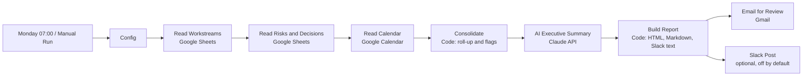

# Weekly Operational Status Update (n8n)

An n8n workflow that collects the week's operating data from where it already lives, computes the roll-up, drafts an executive summary, and delivers a formatted status update for leadership review. It runs every Monday at 07:00 and removes the manual chase, copy-paste and formatting that normally takes half a day.

Built for Chief of Staff, Head of Operations and programme office roles, where a reliable weekly rhythm matters more than a clever tool.

## What leadership receives

One email, same structure every week:

1. **Headline** in two sentences
2. **Scorecard**: green, amber and red workstreams, overdue milestones, open decisions, high risks
3. **Needs leadership attention**: up to three items to act on or decide
4. **Watch list**: items likely to become problems within two weeks
5. **Workstream table** with owner, status, progress, next milestone and due date
6. **Decisions needed** and **open risks**, sorted by urgency
7. **Leadership checkpoints** from the calendar for the next 7 days
8. **Stale updates**: workstreams whose owners have not updated the tracker

See a finished example in [`samples/output/weekly_status.html`](samples/output/weekly_status.html) (open in a browser) or [`samples/output/weekly_status.md`](samples/output/weekly_status.md).

## The operating principle

Leadership reports lose trust the first time a number is wrong. So the design splits the work:

| Job | Done by | Why |
|---|---|---|
| Reading the tracker, counting statuses, flagging overdue and stale items, sorting decisions | **Code** | Deterministic. Same data, same result. |
| Writing the headline and the attention and watch lists | **Claude** | Turns the computed facts into plain language. |
| Reading it before it reaches leadership | **A person** | Report goes to the reviewer first. |

If the AI step fails or is switched off, the report still sends with a rule-based summary. Nothing in the scorecard or tables depends on the model.

## How it works



Node-by-node detail is in [`docs/node-reference.md`](docs/node-reference.md).

## What you need

- n8n 1.x (cloud or self-hosted)
- A Google Sheet with two tabs: `Workstreams` and `Risks and Decisions` (column spec in [`docs/data-contract.md`](docs/data-contract.md); copy-ready CSVs in `samples/input/`)
- Google account access for Sheets, Calendar and Gmail
- An Anthropic API key (optional: the workflow works without it)
- Slack (optional)

## Setup

Short version. Full walkthrough and troubleshooting: [`docs/setup.md`](docs/setup.md).

1. **Create the tracker.** Import `samples/input/workstreams.csv` and `samples/input/risks_decisions.csv` into two tabs of one Google Sheet, then replace the sample rows with your own.
2. **Import the workflow.** In n8n: *Workflows > Import from file* > `workflow/weekly-ops-status.json`.
3. **Add credentials.** Google Sheets, Google Calendar and Gmail (OAuth2). For Claude, create an *HTTP Header Auth* credential with header name `x-api-key` and your Anthropic API key as the value.
4. **Edit the Config node.** Set `sheetId`, `reviewRecipient` and, if needed, tab names, calendar and keywords.
5. **Test.** Open the workflow and run *Manual Run*. A review email should arrive in under a minute.
6. **Activate.** Leave `reviewRecipient` as yourself for the first two to three weeks. When you trust it, change it to the leadership distribution list.

## Configuration

Everything you are likely to change sits in the **Config** node:

| Field | Default | Purpose |
|---|---|---|
| `reportTitle` | Weekly Operational Status | Email heading and subject line |
| `sheetId` | placeholder | ID from the Google Sheet URL |
| `workstreamsTab`, `risksTab` | Workstreams, Risks and Decisions | Tab names |
| `calendarId` | primary | Which calendar to scan |
| `calendarKeywords` | steering\|review\|board\|milestone\|decision\|go-live\|deadline | Only events matching this pattern appear in the report |
| `reviewRecipient` | you@example.com | Who receives the email |
| `model` | claude-sonnet-5-5 | Claude model for the summary |
| `staleAfterDays` | 10 | Days without an update before a workstream is flagged |
| `milestoneHorizonDays` | 14 | Look-ahead window for upcoming milestones |

To run without AI, disable the **AI Executive Summary** node. The workflow passes data through and uses the rule-based summary.

## Sample input and output

| File | What it is |
|---|---|
| `samples/input/workstreams.csv` | Six fictional workstreams across green, amber and red |
| `samples/input/risks_decisions.csv` | Three open risks, two open decisions, one closed decision |
| `samples/input/calendar_events.json` | Five calendar events, three of which match the checkpoint keywords |
| `samples/output/weekly_status.html` | The email as delivered |
| `samples/output/weekly_status.md` | Same content in Markdown |
| `samples/output/weekly_status_no_ai.md` | Same data with the rule-based summary |
| `samples/output/slack_message.txt` | Optional Slack version |

The output files were produced by running the real Code nodes on the sample input (`node tests/run_local.js --write-samples`). The AI-written lines come from a hand-written stand-in in `tests/mock-ai-response.json`, so they show the intended style and not a live model run.

## Verification

Run the logic checks without n8n or any API access:

```bash
node tests/run_local.js
```

This extracts the two Code nodes straight from the workflow JSON, runs them against the sample data with a fixed date, and checks status counts, overdue and stale flags, closed-item filtering, calendar filtering, the AI path, and both fallback paths.

What this does not cover: the connector nodes (Google Sheets, Calendar, Gmail, Slack, HTTP). n8n changes node parameters between versions. If a node shows a warning after import, open it, re-select the sheet, calendar or recipient, and save. The mapping between nodes does not change.

## Folder structure

```
n8n-weekly-ops-status/
  workflow/
    weekly-ops-status.json     importable n8n workflow
  docs/
    setup.md                   step-by-step setup and troubleshooting
    node-reference.md          what each node does and why
    data-contract.md           required sheet columns and how they are read
    customising.md             adapting the report to your organisation
  samples/
    input/                     sample tracker data and calendar events
    output/                    sample email, Markdown, Slack text
  tests/
    run_local.js               offline check of the Code nodes
    mock-ai-response.json      stand-in for the Claude response
```

## Running it as an operating rhythm

The workflow only works if the tracker is current. What has held up in practice:

- **One owner per row.** Every workstream and every risk has one named person.
- **Update by Friday noon.** The Monday report reads whatever is there. The "Updates missing or stale" section makes gaps visible without a reminder email.
- **Status means the same thing everywhere.** Agree it once: Green is on plan, Amber is at risk with a recovery path, Red needs a leadership decision or intervention.
- **Decisions get a date.** An open decision without a "needed by" date sorts to the bottom and gets ignored. Make the date mandatory.
- **Review first, then widen.** Send to yourself for a few weeks. Fix the tracker, not the report.

## Privacy and data handling

The AI step sends workstream names, owners, progress notes, blockers, decisions and risk descriptions to the Anthropic API. Do not run it on a tracker that holds information you are not permitted to share with a third-party processor. To keep everything inside your systems, disable the AI node.

Never commit exported workflows containing real credential IDs or sheet IDs. `.gitignore` excludes `*.local.json` for this reason.

## Extending

See [`docs/customising.md`](docs/customising.md) for: adding a source (Jira, Asana, Notion, Airtable), keeping a weekly history for trend lines, escalating reds by direct message, and attaching a PDF.

## Licence

MIT. See `LICENSE`.
